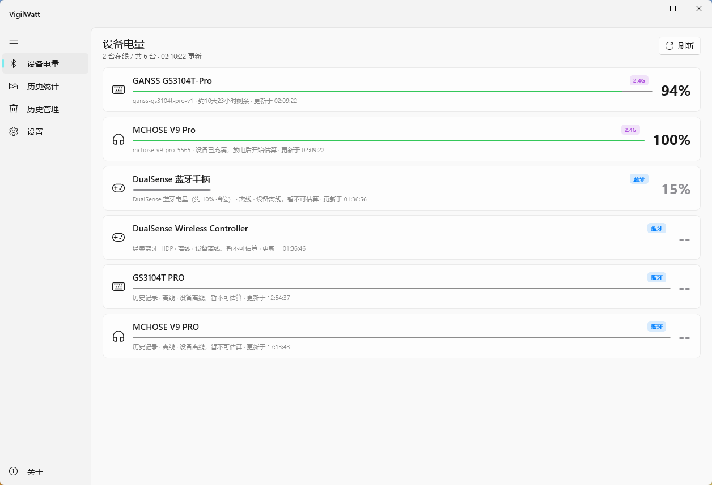

# 贡献者提供的设备电量界面截图

本截图由贡献者提供，用于补充 GANSS GS3104T-Pro、MCHOSE V9 Pro 和 DualSense 电量适配的界面证据。
截图来自名称调整前的本地适配版，图中仍显示旧设备名称；具体版本号未在图中展示，不能将其认作最终贡献分支的重新部署验收。
界面显示“2 台在线 / 共 6 台”，更新时间为 02:10:22。记录条数不等于物理设备数量。

## 截图直接支持的结论

| 条目 | 连接方式标记 | 图中状态 | 能说明什么 |
|---|---|---|---|
| GANSS GS3104T-Pro | 2.4G | 在线，94%，读数更新时间 02:09:22 | 本地适配版可展示接收器读取的键盘电量 |
| MCHOSE V9 Pro | 2.4G | 在线，100%，读数更新时间 02:09:22 | 本地适配版可展示耳机满电数值；不能单凭 100% 校准充电状态 |
| DualSense 蓝牙手柄 | 蓝牙 | 离线，保留 15%，读数更新时间 01:36:56 | 离线后仍展示最近的估算电量；不能证明截图时手柄在线或正在读取 |
| DualSense Wireless Controller | 蓝牙 | 离线，无电量 | 通用蓝牙监视器的无电量条目仍存在；本次没有修改身份合并行为 |
| GS3104T PRO、MCHOSE V9 PRO | 蓝牙 | 离线、历史记录占位，无当前电量 | 已有蓝牙身份占位，不证明截图时标准蓝牙通道正在读取 |

## 验证边界

键盘 BLE 94%、耳机 HFP 100% 与 DS5 在线 15% 的读取证据来自此前真机日志及协议采集，见 [ganss.md](ganss.md)、[mchose-v9-pro.md](mchose-v9-pro.md)、[dualsense.md](dualsense.md)。这张图不替代这些证据。
DS5 的 15% 是约 10% 电量档位的中点估算，不能表示精确 15%。
图中的剩余时间与“设备已充满”提示属于现有界面解释，不能单独用来证明真实续航或已确认的充电协议状态。
截图不验证长期稳定性、其它固件、其它电量点、充电/充满、休眠恢复或多手柄兼容性。

## 图片与隐私

保留贡献者提供的原始 PNG 像素，没有修改设备状态、数值或名称。只使用通用文件名。
可见内容为应用界面、型号、电量和时间，没有个人路径、账号、设备地址、密钥或桌面其它窗口。
PNG 结构检查仅含 IHDR、IDAT、IEND，没有文本或 EXIF 元数据块。
